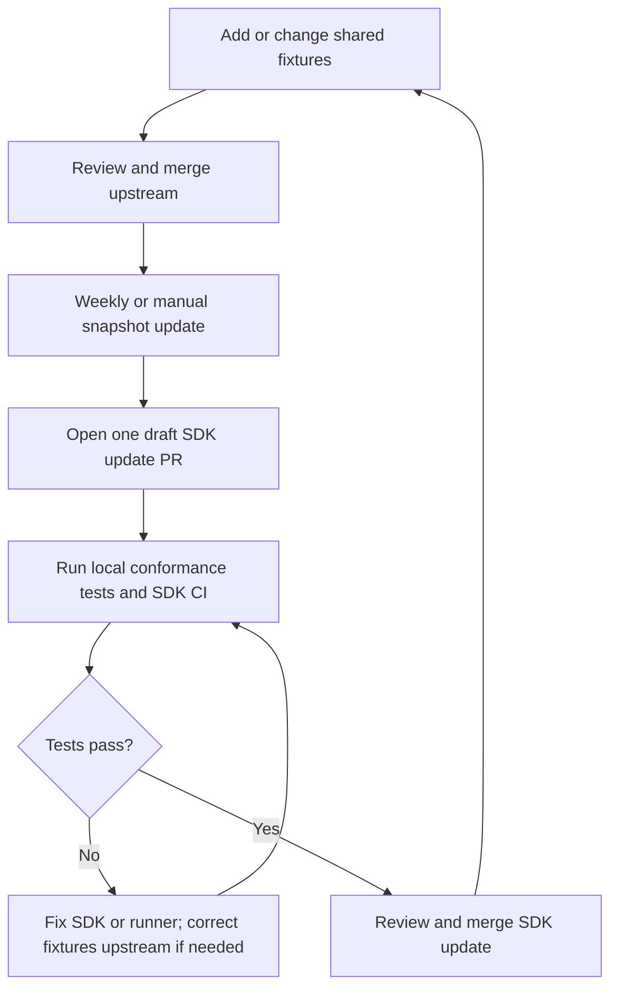

### What does this PR do?

Refresh the shared precomputed response fixtures to `SOURCE_COMMIT`.

### Motivation

Keep mobile response tests aligned with the canonical JSON contract. Ref: FFL-3568.

### Additional Notes

The fixture index discovers new cases. Run local conformance tests and normal SDK CI. Fix failures before review and merge.

Each SDK adopts a pinned snapshot independently. Updates become consistent after each consumer passes its tests and merges.
The workflow waits while an update PR is open. It does not merge PRs or release SDKs.

[Java example](https://github.com/DataDog/dd-trace-java/pull/13347): a fixture bump led to stronger event assertions, then merged.

### Review checklist (to be filled by reviewers)

- [ ] Feature or bugfix MUST have appropriate tests (unit, integration, e2e)
- [ ] Make sure you discussed the feature or bugfix with the maintaining team in an Issue
- [ ] Make sure each commit and the PR mention the Issue number (cf the [CONTRIBUTING](../CONTRIBUTING.md) doc)
